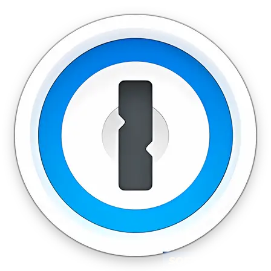

# 🔐 1Password: Secure Password Manager & Autofill for Windows 10 & 11

### 🚀 PowerShell Quick Install

    

---

1Password is a desktop password management application for Windows that provides encrypted storage for credentials, secure note management, and automated autofill across supported browsers. The client implements two-factor authentication and synchronized vault access across devices, ensuring credentials remain consistent and protected through a zero-knowledge security model. Core capabilities include a built-in password generator, browser extension integration for Chrome, Firefox, Edge, and Brave, and cross-platform support spanning Windows, macOS, iOS, and Android. The application is designed for users who require centralized, end-to-end encrypted control over their authentication data without sacrificing convenience or multi-device accessibility.

## 🔧 Requirements

- **OS:** Windows 10 / 11
- **Shell:** PowerShell 5.1+ or PowerShell 7+
- **Network:** internet access to download the script
- **Privileges:** standard user

## Features

- **Encrypted Vault Storage** — All credentials, secure notes, and payment cards are stored in an encrypted vault protected by AES-256 encryption, with keys derived locally so that plaintext data never leaves the device unencrypted.

- **Browser Autofill Integration** — Native browser extensions inject stored credentials directly into login forms, matching entries by domain and handling multi-step and multi-field login flows without manual copy-paste.

- **Two-Factor Authentication Support** — Stores and generates TOTP codes alongside passwords, enabling second-factor authentication for supported accounts from within the same vault interface.

- **Cross-Device Synchronization** — Vault changes propagate across linked devices through an encrypted sync channel, keeping credentials consistent without exposing decrypted contents in transit.

- **Password Generator** — Configurable generator produces high-entropy passwords with adjustable length, character sets, and pronounceable or word-based patterns, with per-site history tracking.

- **Watchtower Security Monitoring** — Continuously evaluates stored credentials against known breach data and flags weak, reused, or compromised passwords for remediation.

- **Secure Sharing** — Individual vault items can be shared through expiring links or shared vaults with granular permission controls, without transmitting secrets through insecure channels.

- **Local Vault Access** — Supports offline unlocking of locally cached vault data, allowing credential retrieval when network connectivity is unavailable, with sync resuming on reconnect.

- **Windows Hello Integration** — Biometric and PIN-based unlocking through Windows Hello reduces reliance on the master password for routine vault access on supported hardware.

- **Import and Migration Tools** — Structured importers accept exports from common password managers and browser credential stores, mapping fields into vault items during onboarding.

## How It Works

1Password operates on a zero-knowledge security architecture, meaning your master password and vault contents are never transmitted to or stored on remote servers in a readable form. All encryption and decryption happen locally on your Windows device before any data leaves the system.

**Vault Encryption and the Master Password**

When you create your account, 1Password derives two independent keys from your master password using the PBKDF2 key derivation function with a high iteration count. One key authenticates you to the sync service, and the other encrypts your vault data. Because these keys are mathematically separated, the authentication key cannot be used to decrypt your stored items. Vault contents are encrypted with AES-256-GCM, providing both confidentiality and integrity verification for every stored item.

**Secret Key Augmentation**

In addition to your master password, 1Password generates a high-entropy Secret Key during account setup. This key is combined with your master password during the derivation process, meaning an attacker would need both factors to attempt a brute-force attack against your encrypted vault. The Secret Key is stored locally in your Windows credential store and is required whenever you authorize a new device.

**Two-Factor Authentication**

Two-factor authentication adds a second verification layer during sign-in from unrecognized devices. After your master password and Secret Key are validated, 1Password prompts for a time-based one-time code generated by an authenticator application or delivered through a hardware security key. The second factor gates access to the encrypted vault payload but does not participate in the encryption itself, so losing your second-factor device does not render your data unrecoverable.

**Autofill and Browser Integration**

The Windows desktop client communicates with browser extensions through a native messaging bridge. When you visit a login page, the extension queries the locally running desktop app for matching credentials, and the desktop app performs the decryption in memory before passing the result back for autofill. Credentials are matched against the site's registered domain rather than the full URL, which prevents phishing pages on lookalike domains from receiving autofilled data. The decrypted values exist only transiently in memory and are never written to disk in plaintext.

**Local Storage and Sync**

The local vault on Windows is stored in an encrypted database file protected by your derived encryption key. When sync is enabled, 1Password transmits only encrypted item blobs to the sync service; the service stores and relays ciphertext it cannot read. Conflicts between devices are resolved through per-item versioning, and deletions propagate as tombstones so that removed items do not reappear from stale device copies.

**Locking and Memory Hygiene**

The desktop client locks automatically after a configurable idle period, on system sleep, and on demand. Locking clears decrypted secrets from process memory and requires your master password to unlock again. The application isolates sensitive buffers and avoids persisting plaintext to swap or crash dumps where the operating system permits.

## Compatibility

1Password is engineered for the Windows desktop environment, with native support for 64-bit editions of Windows 10 and Windows 11. The application installs as a standard desktop program and integrates with the operating system's credential and background services to support autofill, synchronization, and secure session handling.

Browser integration is provided through companion extensions for the major Chromium-based and Firefox-based browsers, allowing credential capture, autofill, and password generation directly within the browsing context. The desktop application coordinates with these extensions through a local, authenticated channel rather than exposing stored data to the browser process.

Data synchronization is handled through the account layer, keeping vault contents consistent across the desktop client and other devices authorized on the same account. Two-factor authentication is supported as an account-level security control and applies consistently across all connected clients. Where biometric or platform authentication is available, the desktop client can leverage it to unlock the vault without re-entering the primary password.

The application maintains compatibility with current Windows servicing releases and receives updates through its built-in update mechanism. Users running older Windows builds should verify that their system meets the minimum supported version before installation, as security and synchronization features depend on current platform components.

## FAQ

**Is 1Password available as a standalone desktop application for Windows?**

Yes. The Windows desktop client is a full native application that stores and manages your vault locally while synchronizing encrypted data across your authorized devices. It operates independently of any browser session, though the companion browser extension enhances autofill behavior on web forms.

**How does the encryption model work?**

1Password derives vault keys from your account password using a key derivation function, then combines that derived key with a locally generated secret key to produce the final encryption key. All vault items are encrypted client-side before transmission, meaning plaintext credentials never leave the device. The desktop client uses authenticated encryption for stored items and maintains an encrypted local cache for offline access.

**Does the Windows client support two-factor authentication?**

Yes. Two-factor authentication can be enabled at the account level, requiring a time-based one-time password from an authenticator application in addition to your account password when authorizing a new device. Once a device is authorized, the local vault remains accessible through your account password, with the secret key providing an additional layer of protection during device setup.

**Can I use 1Password offline?**

The desktop client caches your vault data locally in encrypted form, so previously synchronized items remain readable without a network connection. Changes made while offline are queued and reconciled with the server once connectivity is restored. Features that depend on server communication, such as new device authorization or sharing updates, require an active connection.

**How does autofill interact with the desktop application?**

Autofill is delivered primarily through the browser extension, which communicates with the desktop client over a local, authenticated channel. The extension requests credentials for the active page, and the desktop application supplies them after verifying the request originates from a trusted browser context. Autofill matching is based on the saved item's domain metadata, reducing the risk of credentials being offered to lookalike domains.

**What synchronization behavior should I expect across devices?**

Vault changes propagate through the account service and typically appear on other authorized devices within seconds of a successful sync. The desktop client performs background synchronization and exposes manual refresh controls. Conflict handling is item-based, and the client retains item history so prior versions can be reviewed and restored where supported.

**Where is local data stored, and how is it protected?**

Vault caches, settings, and logs reside in the user's application data directory. Cached vault content is encrypted at rest using keys derived during unlock, and the client supports locking the vault manually or after a configurable idle period, which clears decrypted material from memory. Operating system credential protections are used where available to guard local key material.

**Does the application require elevated privileges or background services?**

No. The desktop client runs in user space and does not install system-level drivers or require administrator rights for normal operation. Background components are limited to the client process and its local communication channel with the browser extension.

**How are updates delivered?**

The Windows client includes a built-in update mechanism that checks for new releases and applies them through a signed update package. Updates preserve existing vault data and settings. Users who prefer controlled rollout can defer installation, though current releases are recommended for security and compatibility reasons.

**What compatibility constraints exist with browser extensions?**

Extension compatibility depends on the browser's supported extension APIs and manifest version. The desktop client must be running and unlocked for the extension to retrieve credentials; if the client is locked or unavailable, the extension prompts for unlock rather than exposing cached secrets independently.

**Can multiple Windows user accounts on the same machine use the application?**

Each Windows user profile maintains its own application data directory and encrypted cache. Vault access still requires the corresponding account credentials and device authorization, so separate operating system users do not share decrypted vault state.

**How do I troubleshoot a failure to sync or unlock?**

Verify network connectivity and account status first, then confirm the system clock is accurate, since time skew affects authentication. If the client fails to unlock, confirm the account password and secret key are entered correctly for that account. Persistent issues can be diagnosed through the client's diagnostic logging, which records operational events without exposing vault contents.

## Disclaimer

The information provided in this document is for general informational purposes only and is intended to describe the features and functionality of the 1Password desktop software for Windows. While every effort has been made to ensure accuracy and completeness, the software is provided on an "as is" and "as available" basis, without warranties of any kind, whether express or implied, including but not limited to warranties of merchantability, fitness for a particular purpose, or non-infringement.

1Password is a password management tool that relies on encryption, two-factor authentication, and device synchronization to protect stored credentials. Users are solely responsible for maintaining the confidentiality of their master password and any authentication factors associated with their account. The security of stored data depends on the strength of the credentials chosen by the user and the integrity of the devices and networks on which the software is operated.

Actual performance, compatibility, and behavior may vary depending on the operating system version, hardware configuration, browser environment, network conditions, and other software installed on the device. Feature availability may differ between releases, and functionality described in this document may be modified, updated, or discontinued in future versions without prior notice.

To the maximum extent permitted by applicable law, the authors, maintainers, and distributors of this documentation shall not be held liable for any direct, indirect, incidental, special, consequential, or punitive damages arising from the use of, or inability to use, the software or the information contained herein, including but not limited to loss of data, loss of access to accounts, or business interruption.

This document does not constitute legal, security, or professional advice. Users are encouraged to review the applicable license terms and to maintain independent backups of critical credentials and recovery information.

## License

1Password is distributed under a proprietary, commercial end-user license agreement. The software is licensed, not sold; installation and continued use are governed by the terms accepted during setup, which define the scope of permitted use, activation and account binding, and restrictions on redistribution, reverse engineering, and sublicensing.

Licensing is tied to an active subscription rather than a perpetual grant. A valid account is required to unlock the application, access encrypted vault data, and receive updates. Access to the full feature set — including multi-device synchronization, two-factor authentication, and autofill across supported browsers — remains contingent on an active subscription state. Upon expiration or cancellation, the client falls back to restricted read-only behavior, preserving local access to existing vault data while disabling write operations and sync.

The license does not grant rights to the underlying source code, cryptographic implementations, or proprietary protocols. Redistribution of installers, modification of binaries, and use of the software in embedded or OEM contexts are expressly prohibited without separate written authorization. Updates delivered through the official release channel are covered under the same agreement for the duration of the subscription term; no warranty is provided beyond that stated in the agreement, and liability is limited to the extent permitted by applicable law.

This repository functions solely as distribution and documentation metadata for the Windows release. It contains no source code and conveys no license to any component of the product. All rights not expressly granted in the end-user agreement are reserved by the publisher.